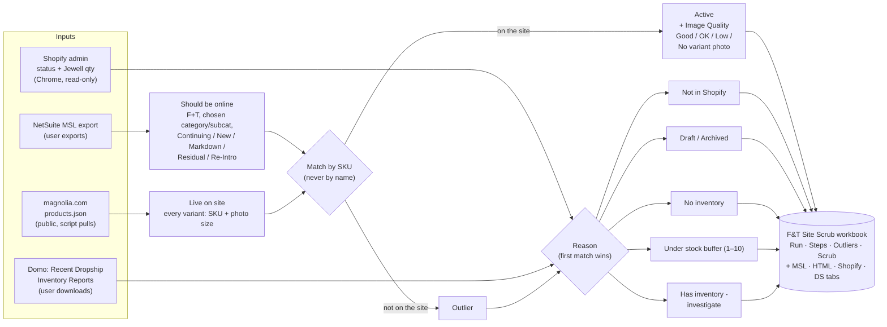

# Website Scrub

Check that every Furniture + Textiles SKU that should be online is live on magnolia.com, for
a whole MH Category (e.g. Upholstery) or one MH Sub-Category (e.g. Uph Seating), and explain why the ones that aren't have fallen off.

- **When:** weekly (started 10/19/2026), rotating through subcats, or on request.
- **Answers three questions:** (A) are the right items online, (B) is every color/size SKU there
  as a variant, (C) are the pictures a proper resolution.

## How it works



Inventory for the Reason comes from Domo for dropship SKUs and from Shopify (Jewell Warehouse)
for everything else.

1. **Should be online** = MSL rows with MH Division = Furniture + Textiles, the chosen
   MH Category or MH Sub-Category, and Stage = Continuing, New, Markdown, Residual or Re-Intro.
2. **Site pull** ("HTML" tab) = public `magnolia.com/products.json`, every variant with its SKU
   and the image a shopper sees for it.
3. **Compare by SKU** (never by name). On the site = Active. Not on the site = outlier.
4. **Reason** for each outlier, first match wins:

   | Reason | Rule |
   |---|---|
   | Not in Shopify | No Shopify variant has this SKU |
   | Draft / Archived in Shopify | Shopify product status isn't Active |
   | No inventory | Inventory is 0 or less (or no record) |
   | Under stock buffer | Inventory 1–10 (buffer = 10, the user's working assumption) |
   | **Has inventory - investigate** | Over 10 and Active in Shopify, yet not live. These are the real problems. |

   Inventory = DS report **Quantity** for dropship SKUs (MSL "Is Dropship Item" = Yes), Jewell
   Warehouse **available** for the rest.

5. **Image quality** on the shorter side of the image: Good (1500+), OK (1000–1499), Low (<1000).
   A variant on a multi-variant product with no photo of its own = "No variant photo".

## Inputs

| Input | Where it comes from |
|---|---|
| MSL | Raw NetSuite Master MSL export (link in the Merch Processes README). Any sheet with SKU, Stage, MH Division, MH Sub-Category columns. |
| DS report | Newest "Recent Dropship Inventory Reports" export (sheet with SKU + Quantity). See `ds-inventory-report`. |
| Shopify | Admin pull, step 2 below. |
| Site | Pulled by the script. |

F+T categories: subcats (10/19): Bedding: Shams, Sheets, Top of Bed · Case Goods: Beds, Seating, Storage, Tables ·
Lighting: Ceiling, Table + Floor, Wall Lighting · Outdoor: Outdoor Seating, Outdoor Storage,
Outdoor Tables · Pillows + Throws: Pillows, Throws · Rugs: Area Rugs · Soft Bath: Bath Mats,
Bath Textiles · Upholstery: Sofas + Sectionals, Uph Beds, Uph Ottomans and Benches, Uph Seating.

## Steps

1. Make a work folder, e.g. `OneDrive Desktop\Site Scrub <M.D.YY>`. Put the MSL and DS files there.
2. **Shopify pull** (Chrome, user already signed in to the Shopify admin; never type a password):
   - Open any `admin.shopify.com/store/magnoliamom` page and run `scripts/shopify_pull.js` in it.
   - Check `window.jw` until `done` is true. If `err` says the Jewell location changed, stop and tell the user.
   - Get `window.tsv` onto disk through OneDrive (the clipboard route failed on 10/20: Chrome's
     clipboard never reached Windows):
     1. Add a one-time capture-phase `pointerdown` listener on `window` that runs
        `window._sp = window.open('https://magnoliahomes-my.sharepoint.com/_layouts/15/blank.htm')`,
        then click empty space in the dark top bar (about x=200, y=26). The new tab joins the group.
     2. In the SharePoint tab, add a `message` listener that keeps `e.data` when
        `e.origin === 'https://admin.shopify.com'`. In the admin tab, `_sp.postMessage(tsv, 'https://magnoliahomes-my.sharepoint.com')`.
     3. In the SharePoint tab, get a digest from `/personal/ellejansick_magnolia_com/_api/contextinfo`
        and POST the text to `.../_api/web/GetFolderByServerRelativeUrl('/personal/ellejansick_magnolia_com/Documents/Desktop/<work folder>')/Files/add(url='shopify_variants.tsv',overwrite=true)`.
     4. Wait for OneDrive to sync the file locally (same byte size), then close both tabs.
3. **Run the scrub** by sub-category (`--subcat`) or category (`--category`); repeat either for more than one, or mix them:
   ```
   python scripts/site_scrub.py --msl "<MSL>.xlsx" --ds "<DS report>.xlsx" --shopify "<work folder>\shopify_variants.tsv" --subcat "Uph Seating" --out-dir "<work folder>"
   python scripts/site_scrub.py ... --category "Upholstery" --out-dir "<work folder>"
   ```
   A misspelled name stops the run and lists the valid choices.
   Output: `F&T Site Scrub <category or subcat> <MM.DD.YY>.xlsx`. It shows its work:

   | Tab | What's on it |
   |---|---|
   | **Run** (green) | Settings you can change (stage list, stock buffer, image cutoffs) + counts, all COUNTIF formulas |
   | **Steps** (green) | What was done, in order, with the number of SKUs at each step |
   | **Outliers** (green) | SKUs that aren't online, "investigate" first; every column looks up Scrub |
   | **Scrub** (green) | One row per should-be-online SKU: SKU / Name / Variant / Active / Image Quality / Inventory / Reason. Every answer is an XLOOKUP / IF formula into the data tabs |
   | **MSL** (blue) | The MSL rows for the category/subcat, all stages, with a Should Be Online? formula |
   | **HTML** (blue) | The site pull for the subcat: variant, own photo?, image width/height, quality formula |
   | **Shopify** (blue) | Product status + Jewell available/on hand for the subcat's SKUs |
   | **DS** (blue) | DS report rows for the subcat's SKUs |

   Change the stock buffer on Run and the Reasons recalculate. The Outliers list itself (which
   SKUs, and their order) is fixed at run time.
4. Report the counts and the "investigate" rows. Hand the file to the user. Don't send it.

## Rules

- Match by SKU, never by name.
- Read-only everywhere: nothing is changed in Shopify, NetSuite or on the site.
- magnolia.com rate-limits: one site pull at a time (the script pauses between pages).
- The user decides what the outliers mean; the Reason column is only the first check.

## Known gaps

- Stock buffer is assumed to be 10 for every SKU. Change `BUFFER` in the script when the real
  rule is known.
- "Has inventory - investigate" SKUs are Active in Shopify but not on the site. The likely causes
  (not published to the Online Store, `netsuite-hide_online-true` tag) aren't checked yet.

Tested 10/19/2026 on Uph Seating: 978 should be online, 773 live, 205 outliers (173 no inventory,
20 not in Shopify, 4 under buffer, 8 investigate, all Four Hands with DS stock).

Tested 10/19/2026 on the Upholstery category: 2,806 should be online, 2,443 live, 363 outliers (matches the hand-built 10/19 scrub).
